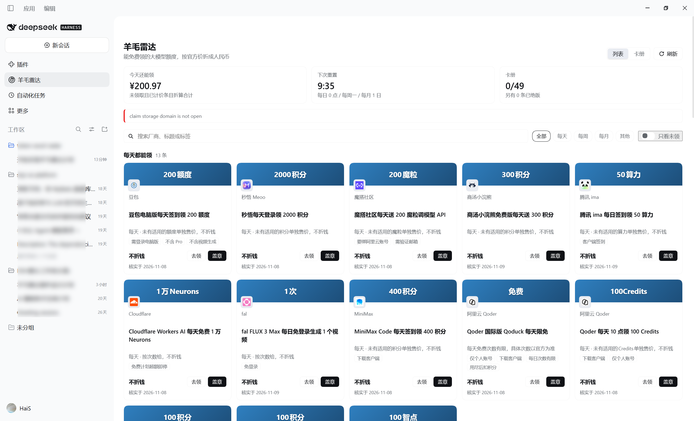
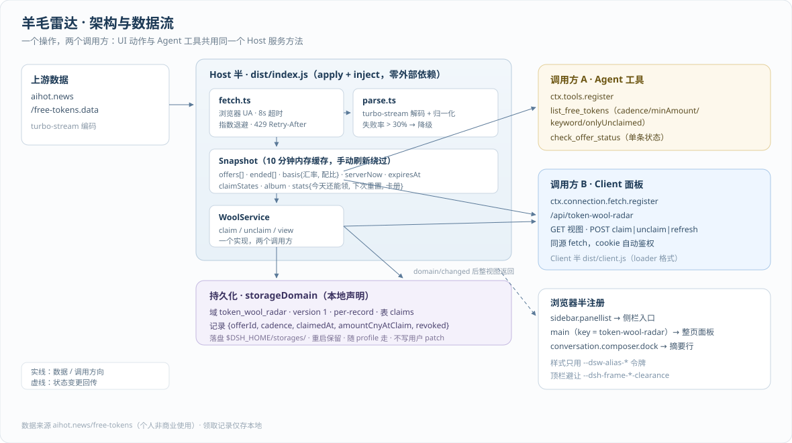

# 羊毛雷达 · Token Wool Radar

>  DeepSeek Harness 插件：把散落各处的「大模型免费额度」收进一张雷达图——按官方价折算人民币，能盖章、能收集、能问 Agent。

[English](#token-wool-radar) · 数据来源 [AIHOT](https://aihot.news/free-tokens)（个人非商业使用）

## 这是什么

每次想薅大模型羊毛，都要在五六个厂商页面之间来回翻：这个每天签到送 200 额度，那个新用户给 20 美元，还有一个学生认证领 300 元——值多少钱、今天还能领多少、领过没有，全凭脑子记。

羊毛雷达替你做三件事：

1. **汇总**：定时抓取 AIHOT 的 Token 羊毛清单，按官方价统一折算成人民币；
2. **追踪**：领没领、什么时候领的、值多少，盖章可撤销，卡册长期保留（重启不丢）；
3. **可问**：同一个数据源同时开放给面板和 Agent——直接问「今天有什么羊毛能领」就能拿到结构化答案。

## 界面与架构

**整页面板**（侧栏入口 ↔ `main` 面板；结构示意——文案与数字取自真实组件字典与线上快照，非运行截图）：





**系统架构**（Host 半 / Client 半 / 两个调用方 / 持久化）：



> 想在 README 里放真实运行截图：在 Harness 里打开面板后截图，存为 `docs/images/panel.png`（面板）与 `docs/images/dock.png`（摘要行），把上面两行图片地址换过去即可。

## 功能

- **整页面板**：侧栏入口一键开合，不与窗口按钮重叠（跟随宿主 `--dsh-frame-top-clearance`）
  - 统计三数字：今天还能领 ¥X · 下次重置 H:MM · 卡册 n/N
  - 四组分类：每天都能领 / 每周都能领 / 每月都能领 / 其他福利，空组不渲染
  - 搜索 + 周期筛选 + 只看未领，可叠加；每条带核实日期，过期条目不进列表
  - 盖章动画（0.18s 落下）、hover 删除线、点击撤销；等级按首次领取当时价值定级，已得不升不降
  - 卡册视图：已收集按等级排序、虚线占位、等级分布与进度
- **Composer 摘要行**：`羊毛 ¥201 · 重置 12:51 · 卡册 3/49`，点击回到面板
- **Agent 工具**（与面板共用同一 Host 服务方法，不重复实现）
  - `list_free_tokens`：按 cadence / minAmount / keyword / onlyUnclaimed 过滤
  - `check_offer_status`：查单条状态（是否有效、折算值、周期、本周期是否已领）

## 安装

需要 DeepSeek Harness 桌面端（0.2.2-rc.1 起）。在 Harness 会话里对 Agent 说：

```text
用 plugin_manager 的 install_bundle 安装 E:\dsh-plugins\token-wool-radar
```

或直接调用工具：

```json
{ "action": "install_bundle", "target": "<本仓库的绝对路径>" }
```

卸载：`plugin_manager(action: 'remove_bundle', target: 'token-wool-radar')`——入口、面板、摘要行、工具与存储域一并消失，零残留。

## 数据来源与口径

- 上游：`https://aihot.news/free-tokens`（React Router 单取端点 `/free-tokens.data`，turbo-stream 编码；页面 HTML 内嵌 payload 为回退路径）
- 折算：上游按官方价换算后直接给出 `yuan`（汇率 6.6713、Token 配比 7:2:1 等口径见 `basis`，面板页脚有注明）；未定价条目显示「不折钱」
- 抓取：浏览器 UA、8s 超时、指数退避重试、429 尊重 `Retry-After`、10 分钟内存缓存、手动刷新绕过缓存
- 降级：解析失败率 > 30% 时只保留原链接与提示；断网保留旧数据并明确报错，**不出现假数据**
- 合规：AIHOT 使用条款为个人非商业免费；本插件按需抓取展示属个人使用。若计划上架插件市场，须先取得书面授权

## 架构

一个操作，两个调用方——UI 动作和 Agent 工具打的是同一个 Host 服务方法：

```
aihot.news/free-tokens.data
   └─ Host: fetch.ts（UA/超时/重试/429/缓存）→ parse.ts（turbo-stream 解码 + 归一化）→ Snapshot
        ├─ Agent 工具：list_free_tokens / check_offer_status（ctx.tools.register）
        └─ Client 面板：/api/token-wool-radar（ctx.connection.fetch.register 鉴权路由，同源 fetch）
用户点盖章 → bridge → Host claim/unclaim → storageDomain 写 → 返回整视图 → 面板刷新
```

- **Host 半** `dist/index.js`：`export function apply(ctx, config)`，零外部依赖
- **Client 半** `dist/client.js`：`window.__ModuleLoader__.load` 格式，React 来自浏览器模块表，样式只用 `--dsw-alias-*` 令牌（卡片 artwork 可用自有颜色）
- **持久化**：插件自声明 storageDomain（`token_wool_radar`，per-record，表 `claims`），落在 `$DSH_HOME/storages/`，随 profile 走，重启保留；不写 localStorage，不写用户 `cordis.patch.yml`

## 开发

```bash
pnpm install                       # 安装构建依赖（esbuild / react / react-dom，仅开发用）
node build.mjs                     # esbuild：src/index.ts → dist/index.js；src/client/index.tsx → dist/client.js
node --test test/*.test.ts         # 40 项测试：线上快照夹具 / 时区周期 / 盖章撤销 / 降级 / 构建产物冒烟 / 工具输出校验
node scripts/make-page-fixture.mjs # 重新生成页面回退路径的精简夹具（缺失时自动抓取线上整页）
```

插件包本身零运行时依赖（Host 半不 import 任何外部模块，Client 半只用浏览器模块表里的 React）。

目录：

```
src/
├── index.ts               # Host 入口：apply + inject
├── bridge.ts              # /api/token-wool-radar 鉴权路由
├── tools.ts               # 两个 Agent 工具（含作者 DSL → JSON Schema 编译）
├── offers/                # types / fetch / parse（turbo-stream）/ convert（Asia/Shanghai 口径）
├── claim/                 # domain（本地域声明）/ service（核心）/ levels（F4 等级表）/ types
└── client/                # index（注册）/ Panel / Card / Album / StatsDock / store / theme.css
scripts/                   # 夹具生成
test/                      # 夹具为线上真实快照（精简页面块 + .data 载荷），无网络用例走夹具
```

## 已知边界

- 宿主 composer 统计行由宿主自绘、无同排插件槽，摘要行按 dock 独立一行实现（默认开启）
- 「下次重置」按每日 0 点 / 每周一 / 每月 1 日（Asia/Shanghai）计算；上游自身的内容刷新时刻不在其数据载荷里
- 上游图标经 `/api/img-proxy` 相对路径引用，面板中解析为绝对地址展示
- 等级表（普通/精良/稀有/史诗/传说）目前按设计文档 F4 的金额分档实现，集中在 `src/claim/levels.ts`，可一处调整

## License

MIT（插件本体）。上游数据版权归 AIHOT 所有，个人非商业使用。
